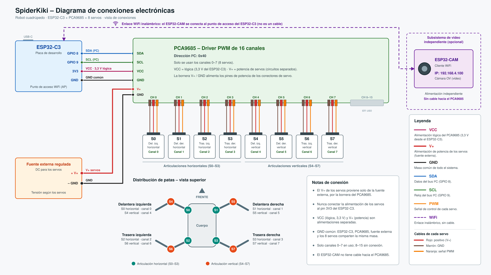

# 🕷️ SpiderKiki
### Robot araña cuadrúpedo controlado por WiFi, ESP32-C3 y servomotores

SpiderKiki es un robot cuadrúpedo de cuatro patas desarrollado con un ESP32-C3, un controlador de servomotores PCA9685 y una interfaz web de control remoto.

El proyecto permite controlar la locomoción del robot, ejecutar movimientos y animaciones preprogramadas, manipular individualmente sus articulaciones y visualizar una transmisión de video en tiempo real mediante una ESP32-CAM.

El objetivo es desarrollar una plataforma robótica modular, accesible y ampliable, combinando electrónica, programación, mecánica y comunicación inalámbrica.

---

## ✨ Características principales

- **Control inalámbrico:** el ESP32-C3 crea su propia red WiFi.
- **Interfaz web:** control desde cualquier navegador conectado a la red del robot.
- **Joystick virtual:** desplazamiento hacia adelante, atrás, giros y movimientos laterales.
- **Locomoción cuadrúpeda:** movimiento coordinado de cuatro patas.
- **Control de servomotores:** ajuste individual de los ángulos de las articulaciones.
- **Acciones programadas:** saludo, flexiones, baile, pelea y diferentes posturas.
- **Transmisión de video:** visualización mediante una ESP32-CAM independiente.
- **Monitor serie:** permite enviar comandos directamente desde el ordenador.
- **Cancelación de movimientos:** posibilidad de interrumpir las animaciones desde la interfaz web.

## 🧠 Arquitectura del sistema

El sistema se divide en tres componentes principales:

### 1. Unidad de control: ESP32-C3

Es el cerebro del robot. Se encarga de:

- Procesar los comandos recibidos.
- Ejecutar los algoritmos de locomoción.
- Coordinar los servomotores.
- Crear el punto de acceso WiFi.
- Alojar el servidor web.
- Gestionar las acciones y posturas.

### 2. Controlador de servomotores: PCA9685

El PCA9685 es un controlador PWM de 16 canales que permite controlar los servomotores mediante comunicación I²C.

Se utiliza para generar las señales de control de los ocho servomotores empleados en la configuración actual.

Configuración:

| Parámetro | Valor |
|---|---|
| Dirección I²C | 0x40 |
| Frecuencia PWM | 50 Hz |
| SDA | GPIO 8 |
| SCL | GPIO 9 |
| Canales utilizados | 0 a 7 |
| Servomotores | 8 |

### 3. Sistema de video: ESP32-CAM

La ESP32-CAM funciona como un módulo independiente.

Se conecta a la red WiFi creada por el ESP32-C3 y transmite imágenes mediante un servidor de streaming.

Dirección de transmisión:

`http://192.168.4.100:81/stream`

---

## 🦿 Sistema de locomoción

SpiderKiki utiliza cuatro patas, cada una con dos articulaciones controladas por servomotores:

- Una articulación horizontal para desplazar la pata.
- Una articulación vertical para levantarla y apoyarla.

### Distribución de servomotores

| Pata | Articulación horizontal | Articulación vertical |
|---|---|---|
| Pata 0 | S0 | S4 |
| Pata 1 | S1 | S5 |
| Pata 2 | S2 | S6 |
| Pata 3 | S3 | S7 |

### Distribución física

```text
                  FRENTE

          PATA 2          PATA 3
          S2 + S6         S3 + S7

          PATA 0          PATA 1
          S0 + S4         S1 + S5

                  ATRÁS
```

### Grupos de movimiento

Para conseguir una locomoción coordinada, las patas se dividen en dos grupos:

**Grupo A**
- S0 y S3: articulaciones horizontales.
- S4 y S7: articulaciones verticales.

**Grupo B**
- S1 y S2: articulaciones horizontales.
- S5 y S6: articulaciones verticales.

La caminata se desarrolla mediante seis fases:

1. Levantar el grupo A.
2. Desplazar horizontalmente las patas del grupo A.
3. Apoyar el grupo A.
4. Levantar el grupo B.
5. Desplazar horizontalmente las patas del grupo B.
6. Apoyar el grupo B.

El ciclo se repite mientras el robot recibe una orden de movimiento.

### Corrección de inversión de servos

Los servomotores S4 y S7 tienen una orientación mecánica diferente.

Para compensar esta diferencia, el programa incorpora un sistema de inversión:

`SERVO_INVERTIDO`

La corrección se aplica centralizadamente en `setServoAngleInstant()`, permitiendo que el resto del programa trabaje con los ángulos solicitados sin tener que invertirlos manualmente en cada movimiento.

---

## 🔌 Conexiones electrónicas



### ESP32-C3 → PCA9685

| ESP32-C3 | PCA9685 |
|---|---|
| GPIO 8 | SDA |
| GPIO 9 | SCL |
| GND | GND |
| Alimentación lógica 3.3 V | VCC |

La alimentación de los servomotores debe realizarse mediante una fuente externa regulada adecuada para su tensión y consumo.

**Importante:** unir las masas (GND) de la fuente externa, el ESP32-C3 y el PCA9685. No alimentar los ocho servomotores desde el pin de 3.3 V del microcontrolador.

### PCA9685 → Servomotores

| Canal PCA9685 | Servomotor |
|---|---|
| 0 | S0 |
| 1 | S1 |
| 2 | S2 |
| 3 | S3 |
| 4 | S4 |
| 5 | S5 |
| 6 | S6 |
| 7 | S7 |

Cada servomotor se conecta respetando las tres conexiones de su módulo:

- GND: masa.
- V+: alimentación externa.
- PWM: señal de control.

### Diagrama electrónico


## 📡 Control mediante WiFi

SpiderKiki crea una red inalámbrica propia, por lo que no necesita conectarse a un router ni disponer de acceso a Internet.

### Configuración predeterminada

| Parámetro | Valor |
|---|---|
| Nombre de red | spiderkiki |
| Contraseña | Sin contraseña |
| IP del ESP32-C3 | 192.168.4.1 |
| Puerto web | 80 |
| IP de la ESP32-CAM | 192.168.4.100 |
| Puerto de video | 81 |

### Cómo conectarse

1. Encender el robot.
2. Buscar la red WiFi `spiderkiki` desde un celular o computadora.
3. Conectarse a la red.
4. Abrir un navegador.
5. Ingresar a `http://192.168.4.1`.

Se abrirá el panel de control de SpiderKiki.

**Nota:** la red está abierta en esta configuración. Para un uso más seguro, se recomienda configurar una contraseña WiFi.

---

## 🕹️ Interfaz de control

La página web está desarrollada utilizando HTML, CSS y JavaScript, y se encuentra almacenada directamente en el firmware del ESP32-C3.

No requiere instalar una aplicación.

### Joystick virtual

Permite controlar los desplazamientos del robot:

| Dirección | Comando |
|---|---|
| Arriba | Adelante |
| Abajo | Atrás |
| Derecha | Desplazamiento lateral derecho |
| Izquierda | Desplazamiento lateral izquierdo |
| Diagonal superior derecha | Giro derecho |
| Diagonal superior izquierda | Giro izquierdo |

La zona central funciona como zona muerta para evitar movimientos involuntarios.

### Acciones disponibles

- Acostado.
- Guardar.
- Espera.
- Centrar servomotores.
- Acostar.
- Dormir.
- Saludar.
- Flexiones.
- Pelea.
- Baile 1.
- Baile 2.
- Baile 3.

También dispone de un control manual que permite seleccionar un servomotor y modificar su ángulo entre 0° y 180°.

### Transmisión de video

La interfaz incorpora una ventana de video que recibe el streaming de la ESP32-CAM.

La imagen se muestra rotada 180° según la orientación física de la cámara.

---

## 💻 Software y funcionamiento

El firmware está desarrollado en C++ para Arduino.

### Bibliotecas utilizadas

| Biblioteca | Función |
|---|---|
| `Wire.h` | Comunicación I²C |
| `Adafruit_PWMServoDriver.h` | Control del PCA9685 |
| `WiFi.h` | Creación de la red WiFi |
| `WebServer.h` | Servidor HTTP |

### Organización del programa

El código está dividido en diferentes módulos funcionales:

**1. Configuración**

Define los pines, la frecuencia PWM, los servomotores, los ángulos y las velocidades.

**2. Control de servomotores**

Incluye funciones para mover articulaciones individualmente, coordinar varios servos y realizar transiciones suaves.

Funciones principales:
- `setServoAngleInstant()`
- `setServoAngleSuave()`
- `moverArticulaciones()`
- `moverPatasHorizontales()`

**3. Locomoción**

Calcula los destinos de las patas según la dirección seleccionada y ejecuta las fases de caminata.

Funciones principales:
- `calcularDestino()`
- `calcularDestinoLateral()`
- `ejecutarCaminata()`

**4. Acciones y posturas**

Contiene las secuencias de movimientos preprogramadas.

Funciones principales:
- `accionAcostado()`
- `accionGuardar()`
- `accionSaludar()`
- `accionFlexiones()`
- `accionPelea()`
- `accionBaile1()`
- `accionBaile2()`
- `accionBaile3()`

**5. Comunicación**

Procesa los comandos recibidos por WiFi o por el Monitor Serie.

La función `procesarComando()` centraliza la interpretación de las órdenes.

**6. Interfaz web**

El HTML, CSS y JavaScript se encuentran almacenados en `PAGINA_HTML`.

La comunicación entre el navegador y el ESP32-C3 se realiza mediante solicitudes HTTP:

`GET /cmd?c=<comando>`

**7. Inicialización y ejecución**

- `setup()`: inicializa la comunicación serie, el bus I²C, el PCA9685 y el WiFi.
- `loop()`: atiende las solicitudes web, procesa comandos USB y ejecuta la caminata cuando corresponde.

---

## ⌨️ Comandos del Monitor Serie

También es posible controlar el robot desde el ordenador utilizando el Monitor Serie a 115200 baudios.

| Comando | Función |
|---|---|
| `caminar` | Caminar hacia adelante |
| `atras` | Caminar hacia atrás |
| `derecha` | Desplazamiento lateral derecho |
| `izquierda` | Desplazamiento lateral izquierdo |
| `girarizq` | Girar hacia la izquierda |
| `girarder` | Girar hacia la derecha |
| `parar` | Detener la caminata |
| `detener` | Detener la caminata o cancelar una acción |
| `centro` | Centrar los servomotores |
| `espera` | Volver a la posición de espera |
| `acostado` | Adoptar postura acostado |
| `guardar` | Adoptar postura de guardado |
| `acostar` | Ejecutar movimiento de acostarse |
| `dormir` | Ejecutar acción de dormir |
| `saludar` | Ejecutar saludo |
| `flexiones` | Ejecutar flexiones |
| `pelea` | Ejecutar secuencia de pelea |
| `baile1` | Ejecutar baile 1 |
| `baile2` | Ejecutar baile 2 |
| `baile3` | Ejecutar baile 3 |

Para controlar un servo individual:

` s0 90 `

El formato es `s<canal> <angulo>`.

Por ejemplo, `s4 120` establece el ángulo solicitado del servo S4 en 120°.

---

## 🛠️ Instalación y puesta en marcha

### Requisitos

- ESP32-C3.
- PCA9685.
- Ocho servomotores.
- Fuente externa adecuada para los servomotores.
- ESP32-CAM para utilizar el sistema de video.
- Cables de conexión.
- Arduino IDE.

### Preparación

1. Instalar Arduino IDE.
2. Instalar el soporte de placas ESP32.
3. Instalar la biblioteca Adafruit PWM Servo Driver Library.
4. Conectar el ESP32-C3 al ordenador.
5. Seleccionar la placa correspondiente.
6. Abrir el sketch principal.
7. Verificar las conexiones del PCA9685.
8. Compilar y cargar el programa.

### Primera ejecución

1. Conectar la alimentación del sistema.
2. Abrir el Monitor Serie a 115200 baudios.
3. Comprobar que aparece el mensaje de inicialización.
4. Conectarse a la red `spiderkiki`.
5. Abrir `http://192.168.4.1`.
6. Probar primero los movimientos con el robot asegurado y las patas libres de obstáculos.

---

## ⚙️ Parámetros configurables

Algunos parámetros importantes pueden modificarse directamente desde el código:

| Parámetro | Valor inicial | Función |
|---|---:|---|
| `SERVO_FREQ` | 50 | Frecuencia PWM |
| `SERVOMIN` | 102 | Pulso mínimo |
| `SERVOMAX` | 512 | Pulso máximo |
| `STEP_DELAY` | 12 ms | Velocidad de transición |
| `STEP_SIZE` | 1° | Incremento por paso |
| `VEL_RAPIDA` | 6 ms | Velocidad rápida |
| `VEL_NORMAL` | 12 ms | Velocidad normal |
| `VEL_LENTA` | 20 ms | Velocidad lenta |
| `CENTRO` | 90° | Posición central |

Los valores de calibración de los servomotores pueden variar según el modelo y la mecánica de cada pata.

---

## 🔧 Solución de problemas

| Problema | Posible solución |
|---|---|
| No aparece la red WiFi | Revisar la alimentación y la inicialización del ESP32-C3 |
| No abre la página web | Comprobar que el dispositivo está conectado a `spiderkiki` |
| Los servos no responden | Revisar la alimentación, GND común y conexión I²C |
| Un servo gira al revés | Revisar `SERVO_INVERTIDO` |
| El robot se reinicia al mover las patas | Comprobar si la fuente externa puede suministrar la corriente necesaria |
| No aparece el video | Revisar la conexión de la ESP32-CAM y su dirección IP |
| El joystick no responde correctamente | Revisar la función `comandoDe()` y la transformación de los ejes |

---

## 🚀 Posibles ampliaciones

SpiderKiki está diseñado para poder incorporar nuevas funcionalidades.

Algunas mejoras posibles:

- Agregar sensores IMU para estabilización.
- Incorporar movimientos autónomos.
- Añadir telemetría y visualización de sensores.
- Implementar autenticación en la interfaz web.
- Optimizar la transmisión de video.
- Desarrollar nuevos patrones de locomoción.

---

## 📁 Estructura sugerida del repositorio

```text
SpiderKiki/
│
├── README.md
│
├── firmware/
│   ├── spiderkiki.ino
│   └── camara_spiderkiki.ino
│
├── diagrams/
│   └── diagrama.png
│
├── asseets/
│
└── LICENSE
```

---

## 👩‍💻 Proyecto

**SpiderKiki** es un proyecto de robótica que integra programación, electrónica, diseño mecánico y sistemas embebidos.

Desarrollado por KIKI.